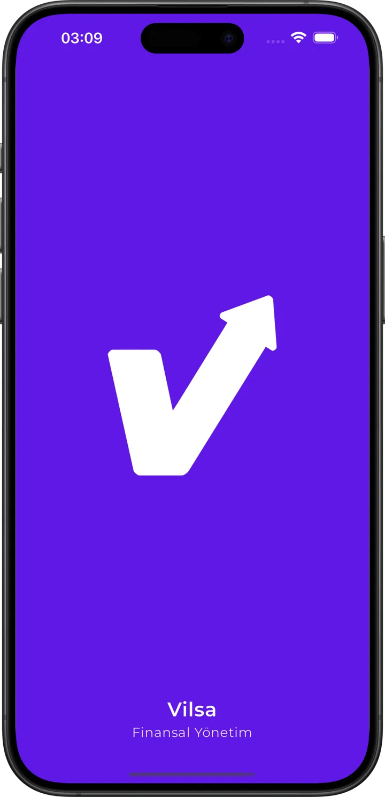
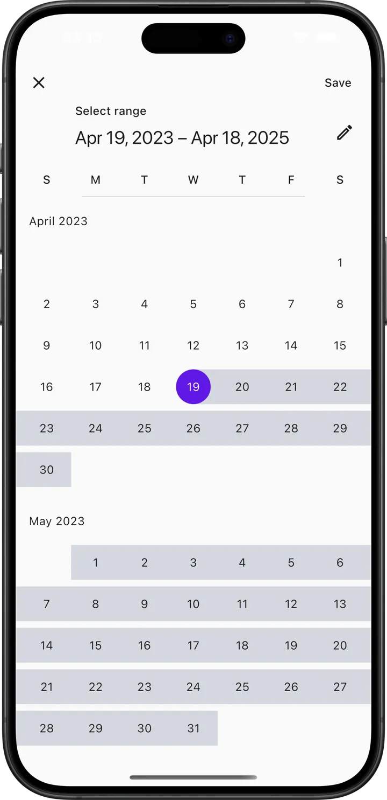
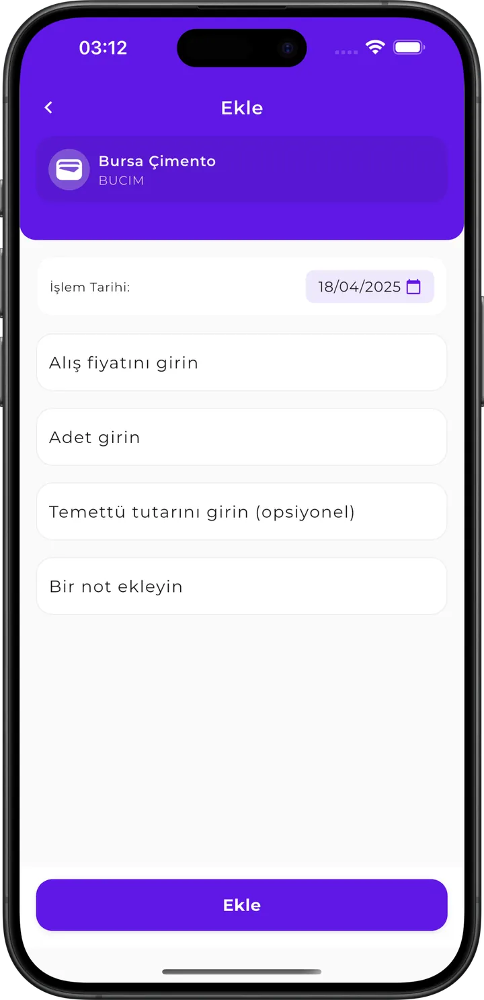
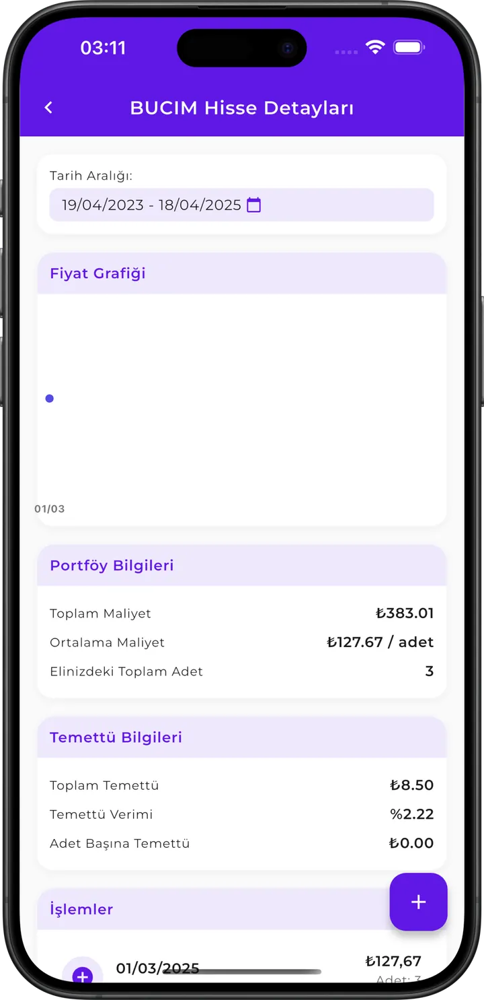

# Vilsa — Stock Portfolio & Dividend Tracker

<div align="center">


### Real-time stock portfolio tracking and dividend analytics.

[](https://flutter.dev)
[](https://dart.dev)
[](https://riverpod.dev)
[](https://firebase.google.com)
[](https://site.financialmodelingprep.com/)
[](https://flutter.dev)

[**Read the Case Study at ahmetkadircicek.com.tr →**](https://ahmetkadircicek.com.tr/projects/vilsa)

<br/>

<p align="center">
  
  
  
  
</p>

</div>

---

## 📈 Overview

**Vilsa** is a personal finance mobile application built with Flutter that empowers investors to monitor their equity portfolios, visualize asset allocation, and forecast future dividend income with precision.

By integrating real-time market data from the Financial Modeling Prep API and syncing user holdings through Firebase, Vilsa eliminates the friction of manual spreadsheets and delivers institutional-grade portfolio metrics in an elegant, mobile-first interface.

---

## ✨ Features

- **Real-Time Portfolio Valuation**: Automatic updates for equity holdings, cost basis, unrealized gain/loss, and total return percentages.
- **Dividend Forecasting & Calendar**: Monthly dividend income schedules, payout dates, ex-dividend notifications, and estimated annual yields.
- **Visual Asset Allocation**: Interactive pie charts and sector breakdown graphs powered by `fl_chart`.
- **Detailed Ticker Analytics**: Company balance sheet metrics, historical price trends, PE ratios, and dividend sustainability scores.
- **Secure Cloud Sync**: Cross-device synchronization backed by Firebase Authentication and Cloud Firestore.
- **Multi-Currency Support**: Real-time currency conversion for international stock exchanges and assets.

---

## 🏛️ Architecture & Folder Structure

```
lib/
├── core/                 # Shared foundations & configurations
│   ├── constants/        # API endpoints, app tokens, colors
│   ├── network/          # HTTP / Dio client & error interceptors
│   ├── services/         # Firebase auth & Firestore sync services
│   └── theme/            # Material 3 light and dark theme configurations
├── models/               # Domain data models (Portfolio, Stock, Dividend)
├── providers/            # Riverpod state providers and controllers
├── screens/              # Top-level UI views
│   ├── portfolio/        # Net worth card & holdings list
│   ├── dividends/        # Upcoming payout calendar & dividend yield
│   ├── search/           # Real-time ticker search & autocomplete
│   └── settings/         # Currency, data refresh & profile options
└── widgets/              # Reusable components (Charts, Cards, TickerTiles)
```

---

## 🔌 Tech Stack & Integrations

| Layer | Technology | Usage |
|---|---|---|
| **Framework** | Flutter (Dart) | Multi-platform rendering (iOS, Android, Web) |
| **State Management** | Flutter Riverpod | Reactive data flow and testable business logic |
| **Market Data API** | Financial Modeling Prep API | Real-time equity quotes, company profiles, dividend data |
| **Data Visualization** | `fl_chart` | High-performance interactive financial charts |
| **Authentication & DB** | Firebase | User accounts and Firestore portfolio data storage |
| **Networking** | `http` / `dio` | REST API consumption with cached responses |

---

## 🚀 Getting Started

### Prerequisites
- Flutter SDK `^3.19.0` or later
- API key from [Financial Modeling Prep](https://site.financialmodelingprep.com/)
- A Firebase project with Firestore and Authentication enabled

### Installation

```bash
# 1. Clone the repository
git clone https://github.com/ahmetkadircicek/vilsa.git
cd vilsa

# 2. Configure environment variables
cp .env.example .env # or edit .env to provide your FMP_API_KEY

# 3. Install dependencies
flutter pub get

# 4. Run on a simulator or connected device
flutter run
```

---

## 👨‍💻 Author

**Ahmet Kadir Çiçek**
- Website: [ahmetkadircicek.com.tr](https://ahmetkadircicek.com.tr)
- GitHub: [@ahmetkadircicek](https://github.com/ahmetkadircicek)
- LinkedIn: [in/akadircicek](https://www.linkedin.com/in/akadircicek)

---

## 📄 License

This project is licensed under the [MIT License](LICENSE).
